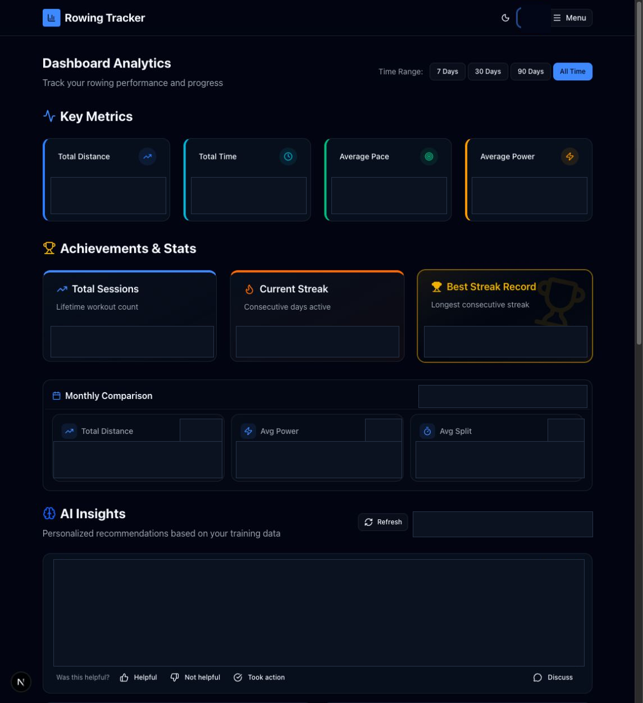

# Dashboard

Route: `/dashboard`

The Dashboard is the at-a-glance home screen. It combines lifetime and time-filtered rowing metrics, streaks, month-to-month comparisons, the latest AI insights, and a configurable metric comparison chart.

## Sections

- **Key Metrics** shows total distance, total time, average pace, and average power for the selected time range.
- **Achievements & Stats** shows lifetime session count, current streak, and the best streak record.
- **Monthly Comparison** compares total distance, average power, and average split for two selected months.
- **AI Insights** shows the newest insight batch, its analysis time, priority, and actionable status.
- **Metric Comparison** plots one metric over a weekly, monthly, quarterly, or yearly period.

## Controls and active elements

| Control | What it does | State or caution |
| --- | --- | --- |
| 7 Days / 30 Days / 90 Days / All Time | Recalculates the top metrics and the data available to the page for that range. | The pressed button is the active range. All Time was active during capture. |
| First month selector | Chooses the month whose metrics are shown as the primary values. | July 2026 was selected during capture. |
| Second month selector | Chooses the comparison month used for the “vs prev” values and percentage direction. | June 2026 was selected during capture. |
| Refresh | Requests a new AI insight analysis from current training data. | **Writes data.** Requires configured cloud AI; the button shows progress while generation runs. |
| View All | Opens the complete Insights module. | The label includes the current total insight count. |
| Helpful / Not helpful | Records feedback for the selected insight. | **Writes data.** The feedback controls disappear after a choice and are replaced by “Feedback recorded.” |
| Took action | Records that the recommendation was acted on. | **Writes data.** Shown only for actionable insights. |
| Discuss | Opens AI Coach with the full insight and a prepared discussion prompt. | Conditional on AI Coach configuration for an actual reply. |
| Bar / line / area icons | Changes the comparison chart visualization. | The pressed icon is the active chart type. |
| Weekly / Monthly / Quarterly / Yearly | Changes the aggregation period of the comparison chart. | Does not alter session data. |
| Distance / Duration / Energy / Avg Power / Avg Pace / Stroke Rate | Selects the value plotted by Metric Comparison. | The selected metric supplies the chart title, units, and aggregation. |
| Chart hover | Shows the period label and exact value for a bar or point. | Read-only. |
| Upload Your Data | Opens Sync when the account has no sessions yet. | Conditional empty-state link. |
| Configure AI Settings | Opens the AI Settings category when insight generation is unavailable because AI is not configured. | Conditional link. |
| View Archived Insights | Opens Insights when no current batch is shown but archived insights exist. | Conditional link; its label includes the archive count. |

The metric and streak cards are informational; clicking them does not navigate.

## Related modules

- Use [Analytics](02-analytics.md) for multiple charts, correlations, custom date ranges, and AI explanations.
- Use [Insights](04-insights.md) to search current and archived recommendations.
- Use [Sessions](03-sessions.md) to inspect the workouts behind the totals.
