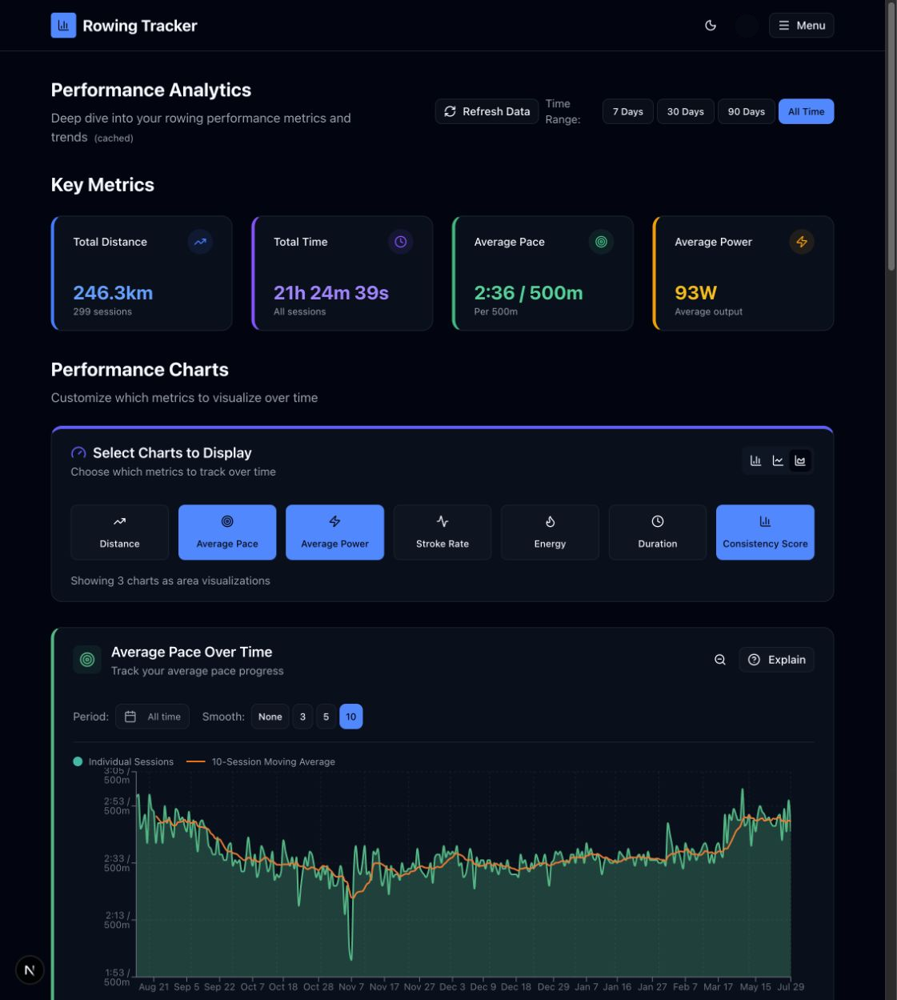

# Analytics

Route: `/analytics`

Analytics is the detailed multi-session analysis workspace. It combines time-filtered summary metrics, selectable trend charts, posture-fault frequency, and performance correlations.

## Sections

- **Key Metrics** repeats the four summary values for the current global range.
- **Performance Charts** can show Distance, Average Pace, Average Power, Stroke Rate, Energy, Duration, and Consistency Score.
- **Posture Fault Frequency** plots recorded mocap faults per session.
- **Performance Correlations** includes Split Time Over Date, Power vs Pace, Stroke Rate vs Pace, Duration vs Distance, Energy vs Duration, Power vs Stroke Rate, and Distance vs Power.

## Global controls

| Control | What it does | State or caution |
| --- | --- | --- |
| Refresh Data | Invalidates the analytics cache and reloads the session-derived dataset. | Read-only with respect to workouts; the button spins while data is loading. |
| 7 Days / 30 Days / 90 Days / All Time | Applies one range to summary metrics, trend charts, correlations, and AI explanation context. | The pressed button is active. |
| Bar / line / area icons | Sets the visualization used by the selectable trend charts. | The selected icon is pressed. Area was active during capture. |
| Metric buttons | Adds or removes Distance, Average Pace, Average Power, Stroke Rate, Energy, Duration, or Consistency Score charts. | The page reports how many charts are currently shown. |

## Per-chart controls

| Control | What it does | State or caution |
| --- | --- | --- |
| Show Full Range / Zoom to Data | Switches the vertical scale between its full domain and a tighter data-focused domain. | Consistency uses the fixed 0–100 full range. |
| Explain | Captures the chart context, prepares an AI explanation request, and opens the corresponding AI Coach conversation. | **Writes a conversation when AI is configured.** Existing valid multi-session explanations can be reused. |
| Period | Opens a two-month calendar for an optional start/end date range, with previous/next month, month quick-jumps, and Reset. | The range is local to that chart. “All time” means no custom range. |
| Smooth: None / 3 / 5 / 10 | Applies no moving average or a 3-, 5-, or 10-session moving average. | Each chart keeps its own smoothing value. |
| Chart hover | Reveals the session date and exact value or the two values in a correlation. | Read-only. |
| Upload Your Data | Opens Sync when the account has no sessions to analyze. | Conditional empty-state link. |

Trend charts distinguish individual sessions from the 10-session moving average in their legend. Correlation charts have their own legends, such as stroke-rate color bands on Split Time Over Date. When no valid posture or consistency data exists, the corresponding section shows an empty state instead of inventing zeroes.

## Related modules

- A chart explanation opens [AI Coach](07-ai-coach.md).
- Posture-fault data comes from [Mocap](08-mocap.md).
- Open [Sessions](03-sessions.md) for stroke-level charts for one workout.
