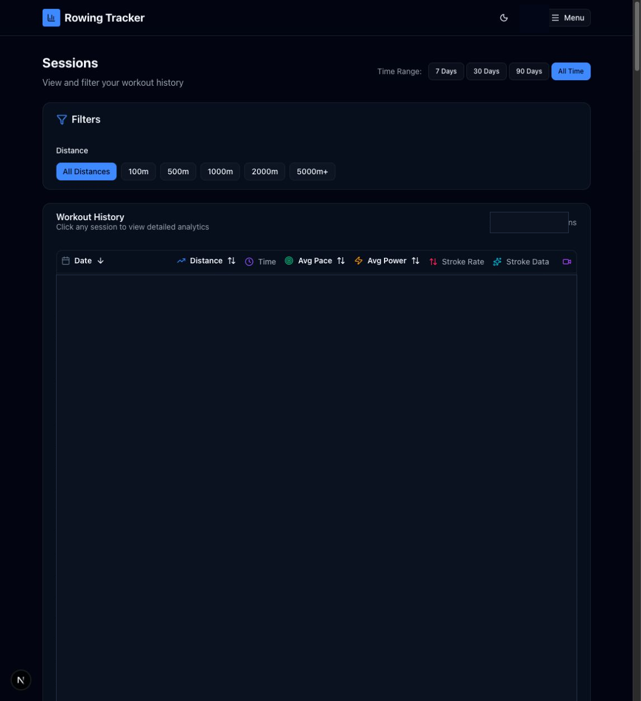
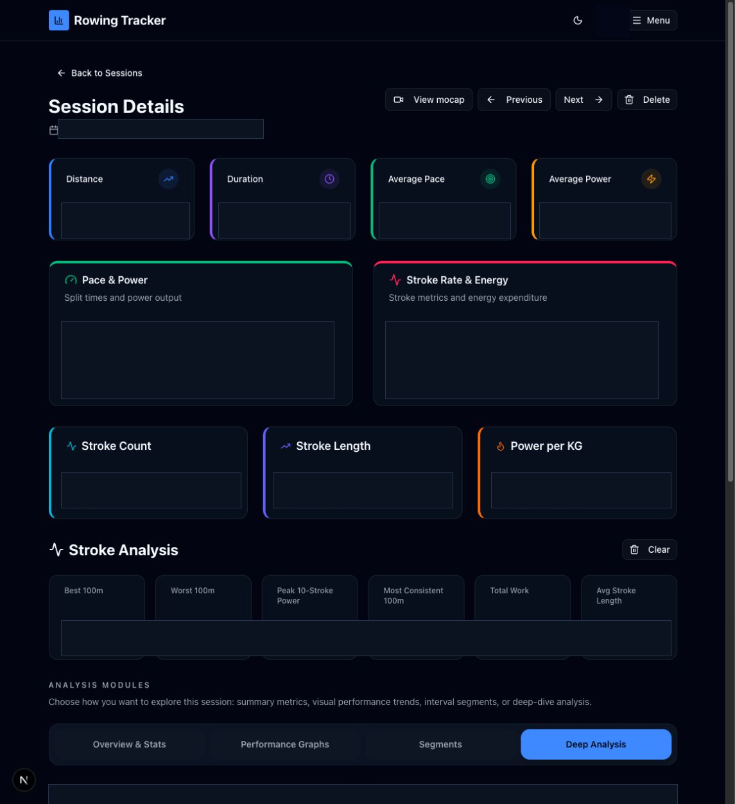

# Sessions

Routes: `/sessions` and `/sessions/{sessionId}`

Sessions is the workout history and the entry point to individual workout analysis. The current account contains both summary-only workouts and enhanced workouts with stroke-by-stroke data.

## Session list

| Control or active element | What it does | State or caution |
| --- | --- | --- |
| 7 Days / 30 Days / 90 Days / All Time | Filters the table by workout date. | The pressed button is active. |
| All Distances / 100m / 500m / 1000m / 2000m / 5000m+ | Filters by the workout distance band. | Combines with the date filter. |
| Date header | Sorts chronologically and toggles ascending/descending on repeated use. | The sort indicator shows direction. |
| Distance header | Sorts by distance and toggles direction. | Read-only. |
| Avg Pace header | Sorts by average split and toggles direction. | Lower time is faster. |
| Avg Power header | Sorts by average watts and toggles direction. | Read-only. |
| Session row or date link | Opens the selected session detail. | The entire row supports pointer, Enter, and Space activation. |
| PR badge | Marks a session that produced a tracked distance record. | Informational; the row remains the navigation target. |
| Enhanced badge | Indicates that stroke rows are available for the detailed analysis tabs. | “No stroke file” means only summary metrics are available. |
| Mocap badge | Opens the linked mocap replay without first opening the rowing session. | Shown only for linked sessions. |
| Clear All | Restores the default date and distance filters. | Appears in the Filters card whenever either filter is active. |
| Clear Filters | Restores all sessions when a filter combination has no results. | Conditional empty-state action. |
| Upload Your Data | Opens Sync when the account has no sessions. | Conditional empty-state link. |

## Session detail

The header and summary area displays distance, duration, average pace, average power, pace/power details, stroke rate, energy, work, stroke count, stroke length, and power per kilogram when the source data provides them.

| Control | What it does | State or caution |
| --- | --- | --- |
| Back to Sessions | Returns to the filtered session list. | Read-only navigation. |
| Previous / Next | Opens the adjacent workout in chronological order. | One direction is omitted at the end of the list. |
| View mocap | Opens the linked mocap replay. | Conditional on a mocap link. |
| Delete | Opens confirmation and permanently removes this rowing session. | **Destructive.** |
| Stroke-data file picker | Selects a detailed SmartRow CSV to enhance this workout. | Conditional when stroke data is missing. **Writes data** after import. |
| Clear | Removes the imported stroke data and its derived analysis from this workout. | **Destructive.** Shown when stroke data exists. |
| Overview & Stats | Shows summary stroke metrics plus Power & Stroke Rate. | Enhanced sessions only. |
| Performance Graphs | Shows Pace Analysis, Work per Stroke, Stroke Length, and Heart Rate when present. | Enhanced sessions only. |
| Segments | Shows interval/segment analysis, rolling power, and rolling split charts. | Enhanced sessions only. |
| Deep Analysis | Shows power distribution, rhythm distribution, rate vs power, and rate vs split. | Enhanced sessions only. |
| Explain icon on a chart | Sends that chart’s title, data, and session context to AI Coach. | **Writes a conversation when AI is configured.** The compact icon is currently not text-labelled in the chart UI. |
| Chart hover | Shows the exact stroke, segment, or metric values. | Read-only. |

The selected analysis tab is remembered by the browser. A session without a stroke file shows the upload panel instead of the four analysis tabs.

## Related modules

- Linked posture data opens in [Mocap](08-mocap.md).
- Distance and performance records link back here from [Personal Records](05-personal-records.md).
- Import new sessions and stroke files through [Sync](09-sync.md).
