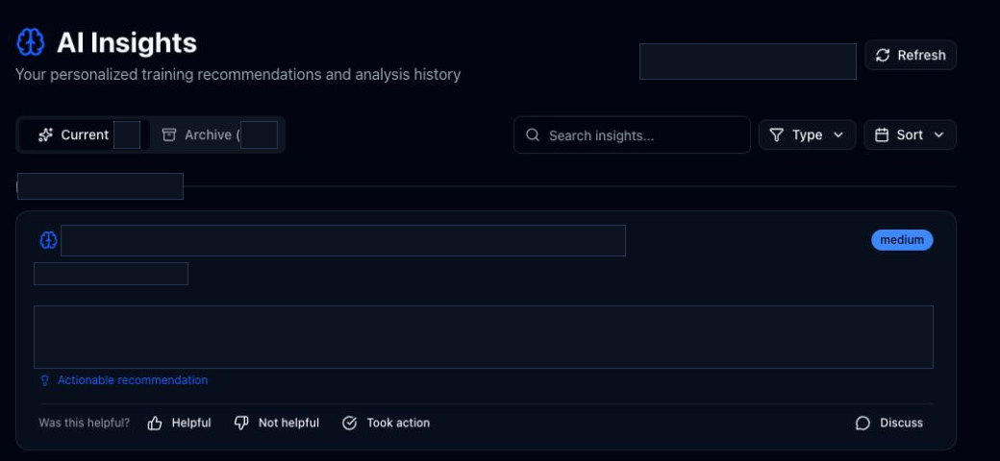

# AI Insights

Route: `/insights`

AI Insights is the searchable history of generated training observations. The current tab holds the newest batch; older batches live in the archive.

## Controls and active elements

| Control | What it does | State or caution |
| --- | --- | --- |
| Refresh | Analyzes current training data and creates a new insight batch. | **Writes data.** Requires a configured AI key and analyzable sessions. Existing current insights move into the archive when replaced. |
| Current | Displays the newest insight batch. | The count reflects the current search and type filters. |
| Archive | Displays prior insight batches. | The count reflects the current filters. |
| Search insights | Searches insight titles and descriptions in the selected tab. | Matching happens as text is entered. |
| Type | Opens multi-select filters for All Types, Trends, Recommendations, Warnings, Achievements, Performance, and Technique. | Selecting All Types clears the specific type choices. Active filters appear as removable badges. |
| Sort | Chooses Newest First, Oldest First, or By Priority. | Priority order is high, medium, then low. |
| Filter badge × | Removes one search or type filter. | The Clear All action appears when filters are active. |
| Helpful / Not helpful | Saves the selected feedback for one insight. | **Writes data.** The row changes to “Feedback recorded.” |
| Took action | Saves action-taken feedback. | **Writes data.** Shown only for actionable recommendations. |
| Discuss | Opens AI Coach with the insight details and a prepared set of follow-up questions. | AI must be configured to receive a reply. |
| Discussion history count | Opens previous AI Coach discussions for that insight. | Conditional; appears only when discussions exist. |
| Delete | Opens confirmation and permanently deletes an archived insight. | **Destructive.** Available only in Archive. |

Each card also displays its type icon, priority, generation date, actionable marker, and—when provided by cloud analysis—confidence and supporting evidence.

## Empty and unavailable states

- With no matching results, the page suggests adjusting the search or filters.
- While Refresh is running, the current panel shows generation progress.
- If cloud AI is not configured, Refresh cannot generate new cloud insights and the page directs the user to Settings.
- The archive remains readable even when AI is currently unavailable.

## Related modules

- The newest insight cards also appear on [Dashboard](01-dashboard.md).
- Discuss opens [AI Coach](07-ai-coach.md).
- AI model, prompt, and personal-context behavior is configured in [Settings](11-settings.md).
