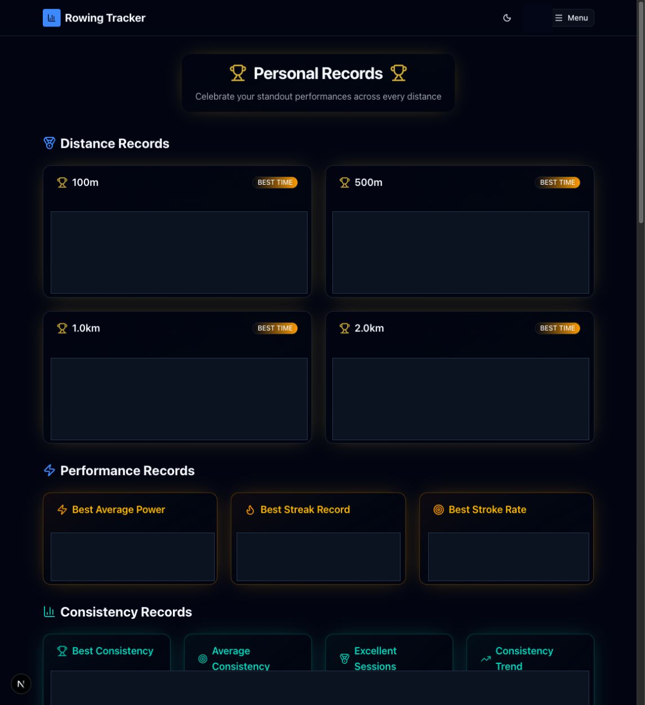
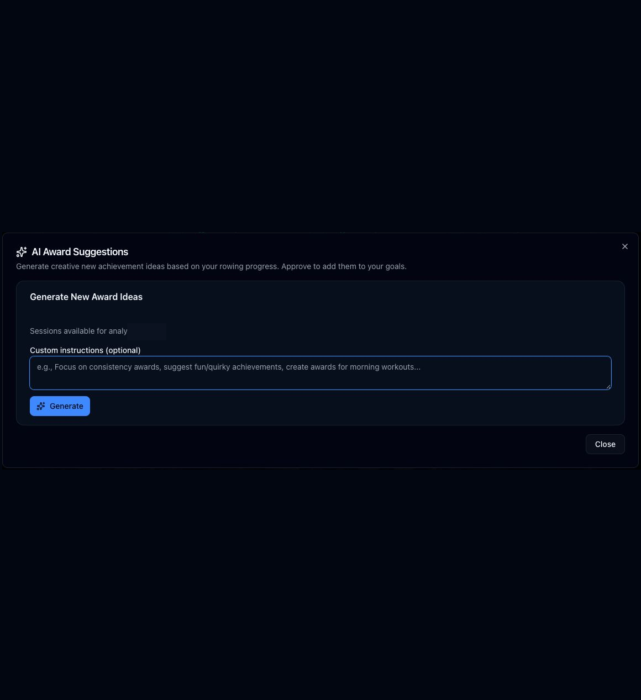

# Personal Records and achievements

Route: `/prs`

Personal Records summarizes standout workouts and the complete achievement catalog. Record cards link back to the workout that earned the result.

## Record sections

- **Distance Records** tracks best times at supported distances such as 100m, 500m, 1,000m, 2,000m, and 5,000m.
- **Performance Records** includes best average power, best streak, and best stroke rate.
- **Consistency Records** includes the best score, average score, excellent-session count, and a recent-vs-baseline trend when enough stroke data exists.
- **Achievements** combines earned awards, in-progress targets, projected target dates, AI awards, and optional generated stories/images.

## Controls and active elements

| Control or active element | What it does | State or caution |
| --- | --- | --- |
| Distance record card | Opens the session that produced that best time. | Disabled as a link when no source session exists. |
| Best Average Power / Best Stroke Rate / Best Consistency card | Opens the source session. | Read-only navigation. |
| Best Streak / aggregate consistency cards | Displays the calculated value only. | Not clickable. |
| Earned achievement card | Opens the achievement gallery at that award. | The card is clickable even though it is not rendered as a semantic button. |
| Gallery previous / next arrows | Moves through earned awards; Left/Right keyboard arrows do the same. | Wraps at each end. |
| Award thumbnail | Jumps directly to that earned award. | Gallery only. |
| Generate Story & Image | Creates and saves both AI artifacts for an earned award. | **Writes data and may incur AI cost.** Requires a configured key. |
| Regenerate story / image icons | Replaces one generated artifact. | **Writes data and may incur AI cost.** |
| Color palette | Chooses the palette used for that award image and saves the selection. | **Writes data.** |
| Download | Downloads the generated achievement image. | Conditional on an image. |
| AI Suggestions | Opens the custom award suggestion dialog. | Does not generate until Generate is pressed. |
| Upload Your Data | Opens Sync when no sessions are available for record calculation. | Conditional empty-state link. |

## AI award suggestions

| Control | What it does | State or caution |
| --- | --- | --- |
| Custom instructions | Adds optional guidance such as a preferred award style or focus. | Free text is sent with the generation request. |
| Generate | Analyzes available sessions and proposes new award definitions. | **May incur AI cost.** Requires configured AI. |
| Approve | Adds a generated suggestion to the account’s award goals. | **Writes data.** Appears on generated suggestions. |
| Delete | Discards an unwanted generated suggestion. | **Destructive.** Appears on generated suggestions. |
| Close / × | Closes the dialog without generating. | Read-only when no suggestion was changed. |

Awards update automatically as new sessions satisfy their criteria. Progress-only cards show a percentage and projected target date; earned cards show the earned date and can open the gallery.

## Related modules

- Record links open [Sessions](03-sessions.md).
- Achievement model, quality, size, palette, and prompt defaults live in [Settings](11-settings.md).
- Importing more workouts through [Sync](09-sync.md) recalculates records and awards.
