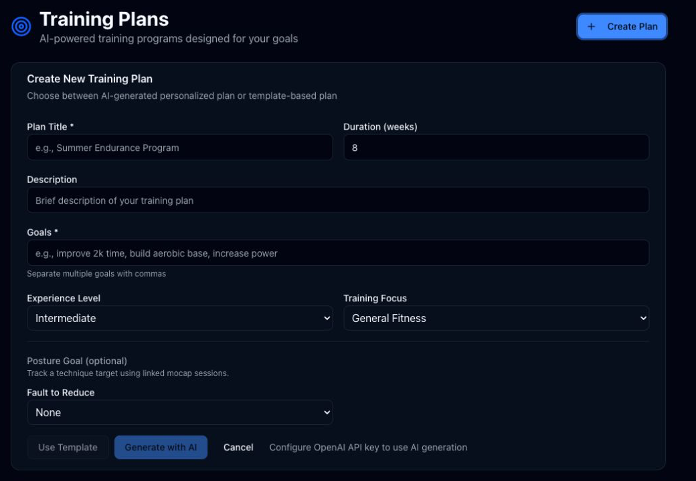

# Training Plans

Route: `/plans`

Training Plans creates and tracks multi-week rowing programs. One plan can be active; other plans remain available for activation, editing, review, reset, or deletion.

## Plan creation

| Control | What it does | State or caution |
| --- | --- | --- |
| Create Plan | Expands the creation form. | No plan is written until Use Template or Generate with AI succeeds. |
| Plan Title | Names the plan. | Required. |
| Duration | Sets the number of weeks. | Numeric field. |
| Description | Adds optional summary text. | Saved with the plan. |
| Goals | Supplies one or more comma-separated goals. | Required. |
| Experience Level | Chooses Beginner, Intermediate, or Advanced. | Used by templates and AI generation. |
| Training Focus | Chooses General Fitness, Endurance, Speed & Power, Strength, or Competition. | Used by templates and AI generation. |
| Fault to Reduce | Optionally attaches one supported mocap posture goal. | Choices match the five v1 posture faults. |
| Use Template | Builds a plan without an AI response. | **Writes data.** Enabled after the required fields are complete. |
| Generate with AI | Sends the form and current training context to the configured model. | **Writes data and may incur AI cost.** Also requires an AI key. |
| Cancel | Collapses the form and discards its unsaved values. | Does not affect existing plans. |

## Active plan

| Control or active element | What it does | State or caution |
| --- | --- | --- |
| Analyze Progress | Prepares the active plan and adherence context and opens a Plan Analysis conversation in AI Coach. | **Writes a conversation when AI is configured.** The current account was redirected to the AI-not-configured state. |
| History icon | Opens saved plan-analysis conversations for this plan. | Icon-only in the current UI. |
| Posture goal selector + Set Goal | Adds or changes the fault target tracked with linked mocap sessions. | **Writes data.** Set Goal is disabled until a fault is selected. |
| Remove posture goal | Removes the active plan's technique target. | **Destructive to that goal.** Shown only when a posture goal exists. |
| Week buttons | Switch the visible week in the schedule. | The selected week is highlighted and remembered. |
| Mark Complete | Marks one scheduled workout complete and updates weeks, sessions, and adherence. | **Writes data.** Completed sessions show their completed state instead. |
| Plan and week progress values | Show weeks complete, sessions done, adherence, goals, and the selected week’s completion. | Informational. |

## All Plans

| Control | What it does | State or caution |
| --- | --- | --- |
| Activate | Pauses the currently active plan and makes the selected plan active. | **Writes data.** |
| View plan details | Opens level, focus, duration, status, goals, progress, and the weekly schedule in a read-only dialog. | Eye icon with tooltip; × closes the dialog. |
| Edit plan | Opens editable title, description, goals, level, and focus fields. | The weekly schedule is explicitly read-only. |
| Cancel / Save Changes | Closes the edit dialog without saving or persists the edited plan fields. | Save Changes **writes data**. |
| Reset progress | Clears the plan’s completion state after confirmation. | **Destructive to progress, not the plan definition.** |
| Delete plan | Permanently removes the plan after confirmation. | **Destructive.** |

In **Plan Analysis History**, each analysis row shows its title, date, message count, and a response preview; clicking the row or chevron opens that conversation in AI Coach. The Latest badge identifies the newest entry, and × closes the dialog. If the history is empty, the dialog explains that Analyze Progress creates the first entry.

Delete and Reset confirmations each provide the named destructive action plus **Cancel**. If no active plan exists, the page shows an empty state with another **Create Plan** button.

## Related modules

- Analysis conversations open in [AI Coach](07-ai-coach.md).
- Posture goals are evaluated from [Mocap](08-mocap.md) sessions linked to rowing sessions.
- AI models, prompts, and personal context are configured in [Settings](11-settings.md).
