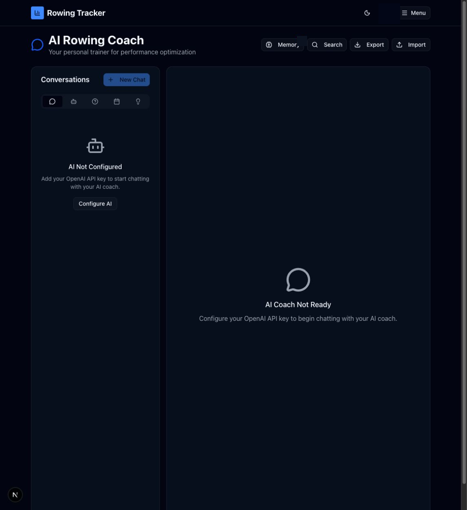

# AI Coach and memory

Route: `/chat`

AI Coach combines normal conversations, chart explanations, plan analyses, and insight discussions. The current account had no configured API key during capture, so existing conversation counts remained visible while New Chat and the message composer were unavailable.

## Header controls

| Control | What it does | State or caution |
| --- | --- | --- |
| Memory + count | Opens the Coach Memory panel and reports the number of stored documents. | The panel may contain private files; filenames are intentionally not shown in this guide. |
| Search | Toggles full-text conversation search. | A result opens the containing conversation. Clear closes the query/results. |
| Export | Downloads conversations as JSON. | Disabled when no conversations exist. |
| Import | Opens a JSON file chooser and imports supported conversation data. | **Writes data.** Review the source file before importing. |
| New Chat | Creates and selects a blank normal conversation. | **Writes data.** Disabled until AI is configured. |

## Conversation sidebar

| Control or active element | What it does | State or caution |
| --- | --- | --- |
| All / Chats / Explains / Plans / Insights | Filters conversations by category. | The tooltip includes the live count. |
| Conversation row | Opens that conversation. | The selected row is highlighted. |
| Edit icon | Replaces the title with an inline editor. Enter/check saves; Escape/× cancels. | **Writes data when saved.** |
| Delete icon | Opens confirmation and removes the conversation. | **Destructive.** |
| Back to chart | Returns an explanation conversation to its source analytics or session chart and scrolls to it. | Explanation conversations only. |

## Chat area

When AI is configured and a conversation is selected, the main panel shows message history, attached files, prompt suggestions, and the message composer.

| Control | What it does | State or caution |
| --- | --- | --- |
| Prompt suggestion | Copies a suggested question into a new request. | Default suggestions can be disabled in Settings; custom suggestions remain available. |
| Message input | Accepts a prompt and optional attachments. | Sending may incur AI cost and writes the messages. |
| File attachment | Adds a local image/PDF or a Memory document to the next message. | File content is transmitted to the configured AI provider when the message is sent. |
| Send / stop | Sends the composed message or stops an in-progress response. | Conditional on input/loading state. |
| Copy message | Copies one message to the browser clipboard. | Read-only. |

## Coach Memory panel

| Control | What it does | State or caution |
| --- | --- | --- |
| Drop zone / browse | Uploads JPEG, PNG, GIF, WebP, or PDF files, up to the displayed limits. | **Writes data.** Uploaded content can be used by AI Coach. |
| Search documents | Filters by document name or description. | Local panel filter. |
| Type selector | Filters All Types, Images, PDFs, Training Plans, Insights, or Notes. | Read-only. |
| Attach to chat | Adds a user document to the current message. | User documents only. |
| View extracted text | Opens the text or generated description stored for a document. | Read-only. |
| Preview document | Opens the stored user file preview. | User documents only. |
| Delete document | Opens confirmation and removes the memory entry/file. | **Destructive.** |
| Export | Downloads the complete memory backup. | May contain sensitive information; store it securely. |
| Close / backdrop | Closes the slide-out panel. | Does not detach documents already added to the composer. |

The **Configure AI** link opens the AI Settings category. Chart Explain, insight Discuss, and plan Analyze Progress all arrive here with a prepared category and prompt.

## Related modules

- Configure AI in [Settings](11-settings.md).
- Explain charts from [Analytics](02-analytics.md) or [Sessions](03-sessions.md).
- Discuss recommendations from [Insights](04-insights.md).
