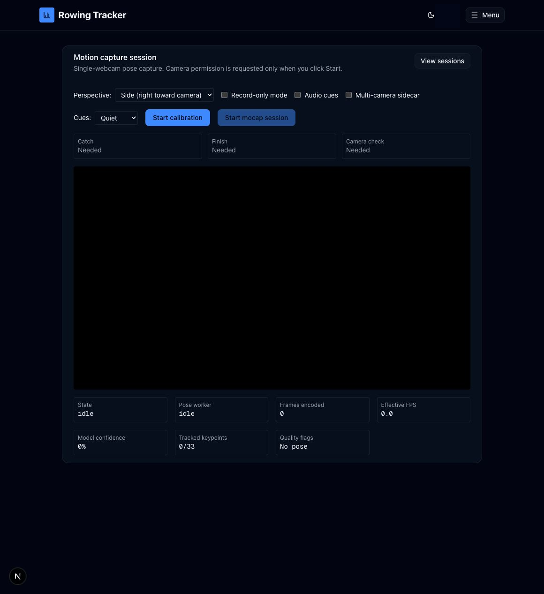
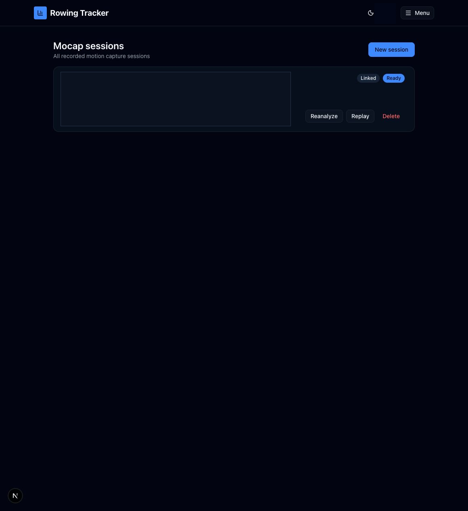
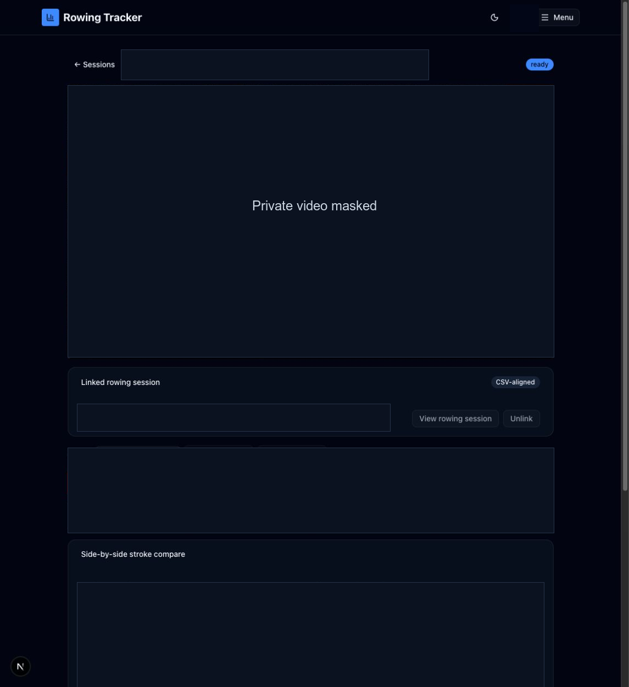

# Motion capture

Routes: `/mocap`, `/mocap/sessions`, `/mocap/sessions/[id]`

Mocap records a side view of an indoor-rowing stroke, derives pose landmarks and technique faults, and can link the result to a rowing session. Camera access is requested only when calibration starts.

## Capture setup

| Control or active element | What it does | State or caution |
| --- | --- | --- |
| View sessions | Opens the Mocap session library. | Read-only navigation. |
| Perspective: side-right / side-left | Identifies which side of the rower faces the camera so joint geometry is interpreted correctly. | Set this before calibration. |
| Record-only mode | Records video without pose analysis. | Record-only recordings cannot later be assigned for pose-backed analysis. |
| Audio cues | Enables spoken technique cues during capture. | Uses the cue detail selected below. |
| Multi-camera sidecar | Enables the supported secondary-camera workflow. | Conditional on browser/device support. |
| Cues: Quiet / Verbose | Selects concise or detailed live feedback. | Also configurable in Mocap Settings. |
| Start Calibration | Requests camera access and starts the calibration workflow. | The browser must grant camera permission. No camera was opened for this guide. |

During calibration, the setup control is replaced by **Capture catch**, **Capture finish**, and **Recalibrate**. A valid catch and finish unlock **Start mocap session** (or the record-only/sidecar equivalent). During a recording, **Stop** ends capture; while processing, the button shows **Finalising** and is disabled.

The status panel exposes the capture state, worker state, received frames, frame rate, average confidence, detected keypoints, and quality flags. A live cue can be closed with **Dismiss cue**. When processing finishes, **View replay** opens the result and **All sessions** opens the library.

## Session library

Each card reports capture time, status, mode, perspective, duration, optional quality score, assignment state, stroke/fault totals, and quality flags.

| Control | What it does | State or caution |
| --- | --- | --- |
| New session | Returns to the capture setup. | Read-only navigation until calibration starts. |
| Reanalyze | Runs pose and fault analysis again. | **Writes data.** Available for ready pose-backed recordings. |
| Assign | Opens an unlinked, pose-backed recording in assignment mode. | Conditional; links it to a compatible rowing session. |
| Replay | Opens video, stroke, and fault analysis. | Available for ready recordings. |
| Delete | Deletes the Mocap session. | **Destructive.** |

Status badges distinguish Ready, Analyzing, Capturing, Linked, Ready to assign, and No pose stream states.

## Replay and assignment

| Control or active element | What it does | State or caution |
| --- | --- | --- |
| Back to sessions | Returns to the library. | Read-only navigation. |
| View rowing session | Opens the linked session detail. | Linked captures only. |
| Assign to session | Links an eligible capture to a compatible rowing session selected in the assignment workflow. | **Writes data.** Unlinked pose-backed captures only. |
| Unlink | Removes the rowing-session link and reanalyzes with pose-based segmentation. | **Writes data** after confirmation. |
| Stroke selector | Moves the replay and metrics to one detected stroke. | The selected stroke is highlighted. |
| Freeze catch / Freeze finish | Pauses at the selected stroke's catch or finish frame. | Read-only replay control. |
| Video controls | Play/pause, seek, volume, and browser-native full-screen controls. | Availability varies by browser. |
| Timeline | Clicking the track seeks to that point; fault markers seek to their timestamps. | Hovering a marker exposes its fault information. |
| Fault summary button | Selects a fault and seeks to its first relevant moment. | Counts summarize the analyzed capture. |
| Fault-heavy / clean comparison selectors | Choose representative strokes for side-by-side technique comparison. | Available when suitable strokes exist. |
| Reanalyze | Re-runs analysis for the current capture. | **Writes data.** |

The replay also shows per-stroke posture metrics, all detected faults, video-quality notes, and the rowing-session link state. Analysis is coaching feedback, not a medical diagnosis.

## Related modules

- Open linked workout data in [Sessions](03-sessions.md).
- Tune thresholds and cue behavior in [Settings](11-settings.md).
- A SmartRow import can suggest a nearby Mocap recording in [Sync](09-sync.md).
