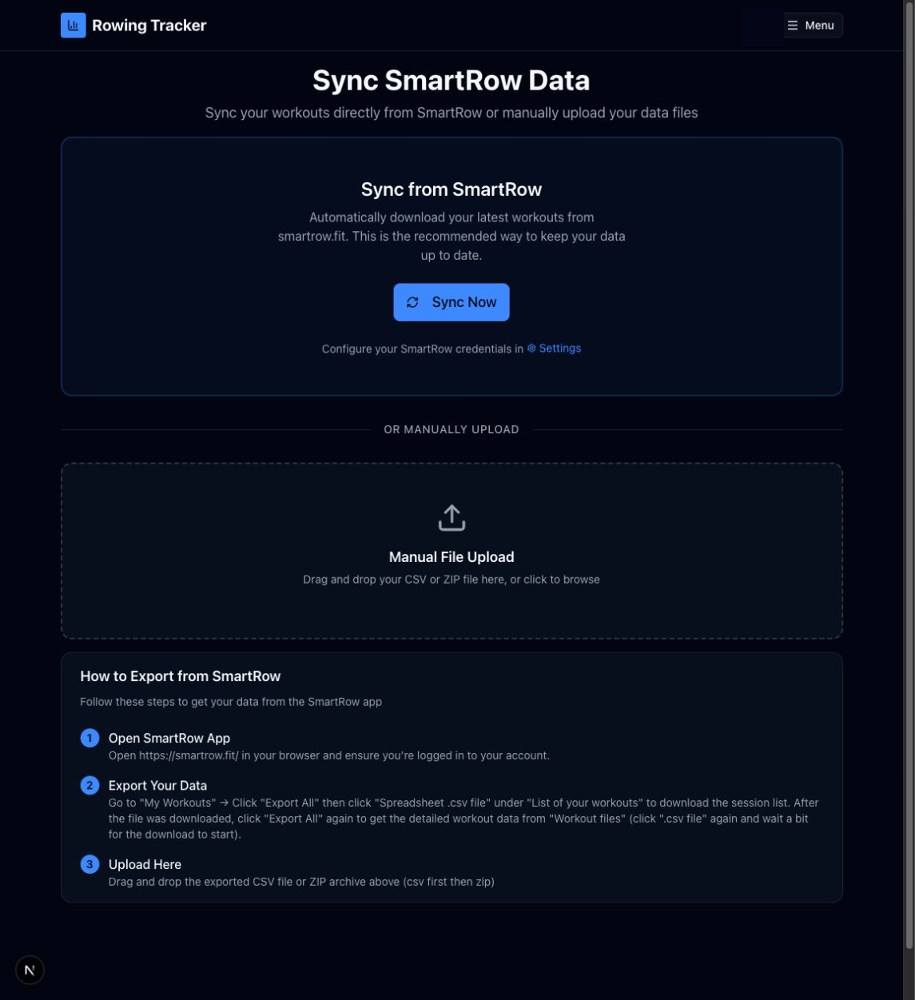

# SmartRow sync and file import

Route: `/sync`

Sync imports SmartRow workouts either directly with saved SmartRow credentials or from exported CSV/ZIP files.

## Import controls

| Control or active element | What it does | State or caution |
| --- | --- | --- |
| Sync Now | Signs in to SmartRow with the credentials stored in Data Management and imports available workouts. | **Writes data.** Network access and valid credentials are required. |
| Settings | Opens Settings, where SmartRow email and password can be saved. | The credentials are private account data. |
| Drop zone / click to browse | Accepts a SmartRow session-list CSV or detailed-workout ZIP. | **Writes data** as soon as a supported file is selected. Drag-and-drop is also active. |
| How to Export from SmartRow | Explains how to export the session list and detailed workout files from SmartRow. | Informational. |

## Progress, completion, and errors

While an import runs, the page displays the selected filename, current processing step, session/chunk progress, and ZIP-file progress when applicable.

| Conditional control or result | What it does |
| --- | --- |
| Try Again | Returns a failed import to the idle upload screen. |
| Choose Different File | Opens the file chooser after a failed import. |
| Import summary | Reports sessions imported, repaired, skipped as duplicates, total distance/time, ZIP updates, skipped files, and a bounded list of issues. |
| Link Mocap | Links a Mocap recording made within two minutes of an imported workout, then enables CSV-aligned posture analysis. **Writes data.** |
| View | Opens the proposed Mocap capture before or after linking. |
| Dismiss | Hides the nearby-Mocap suggestions for the current result screen. |
| Upload Another File | Clears the result and returns to the upload screen. |
| Go to Dashboard | Opens the Dashboard. |

Duplicate workouts are skipped rather than added again. A later detailed ZIP can repair or enrich sessions previously imported from the summary CSV.

## Related modules

- Review imported workouts in [Sessions](03-sessions.md).
- Configure SmartRow credentials in [Settings](11-settings.md).
- Inspect or link video analysis in [Mocap](08-mocap.md).
