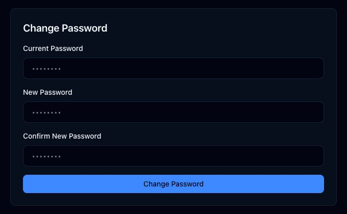

# Profile

Route: `/profile`

Profile manages the account photo, display name, immutable login email, and password. The screenshot is deliberately limited to the password card; no entered value or personal identifier is visible. The eight bullets in each field are identical placeholder text.

## Account information

| Control or field | What it does | State or caution |
| --- | --- | --- |
| Choose/Change photo | Opens an image chooser and uploads a new profile picture. | **Writes data.** The photo appears in the shared header. |
| Remove photo | Removes the current profile picture. | **Destructive.** Available only when a photo exists. |
| Name | Changes the displayed account name. | **Writes data** when Save Changes is selected. |
| Email | Shows the login email address. | Disabled; it cannot be changed on this page. |
| Save Changes | Saves the edited display name. | Disabled while a request is in progress. |

## Change password

| Field or control | What it does | State or caution |
| --- | --- | --- |
| Current Password | Verifies the existing account password. | Masked input. |
| New Password | Sets the replacement password. | Must contain at least eight characters. |
| Confirm New Password | Must match New Password. | Masked input. |
| Change Password | Validates all three fields and updates the password. | **Writes security-sensitive data.** |

Success and error notices appear above the cards after an attempted update.

## Related modules

- General app behavior and data controls live in [Settings](11-settings.md).
- Account navigation and logout are documented in the [guide index](README.md).
