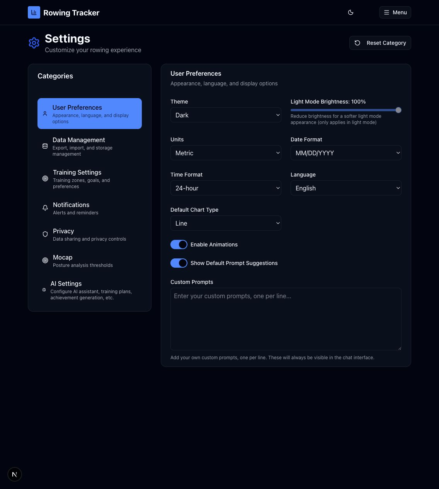
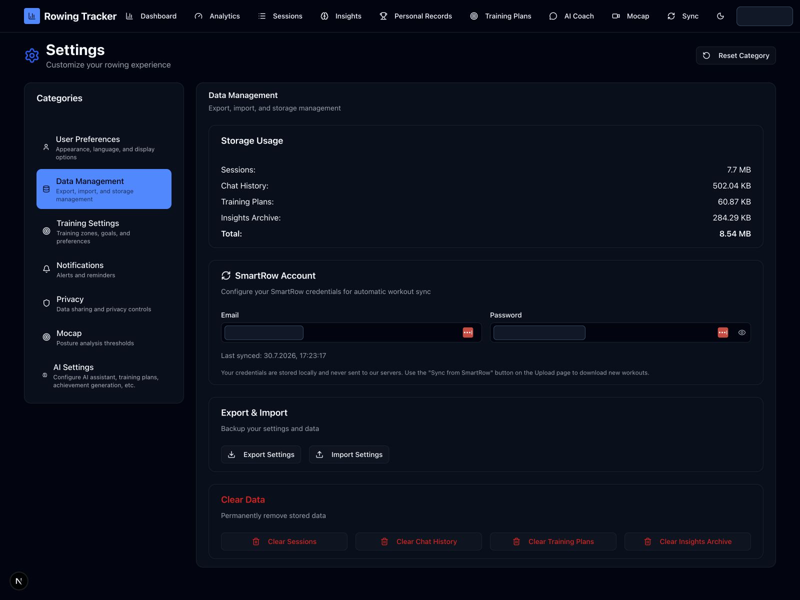
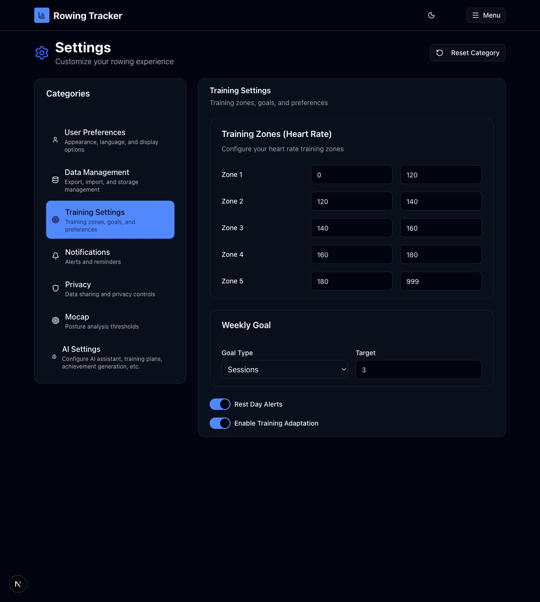
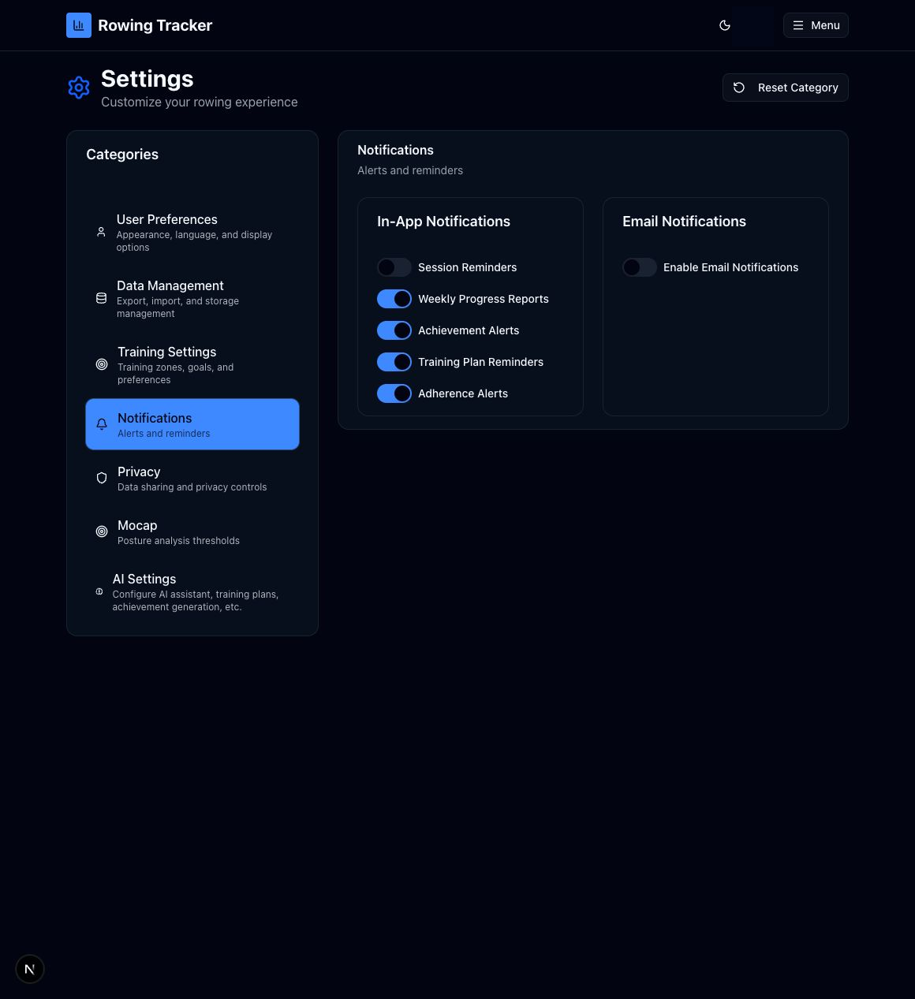
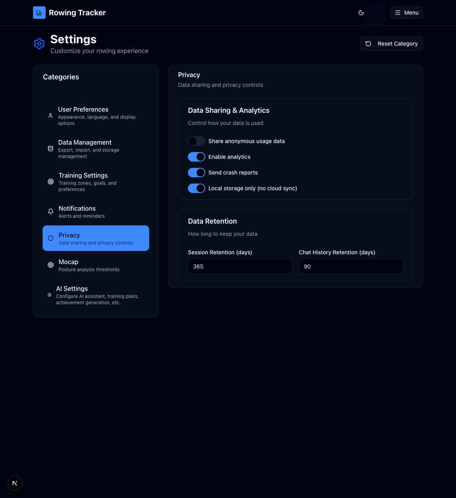
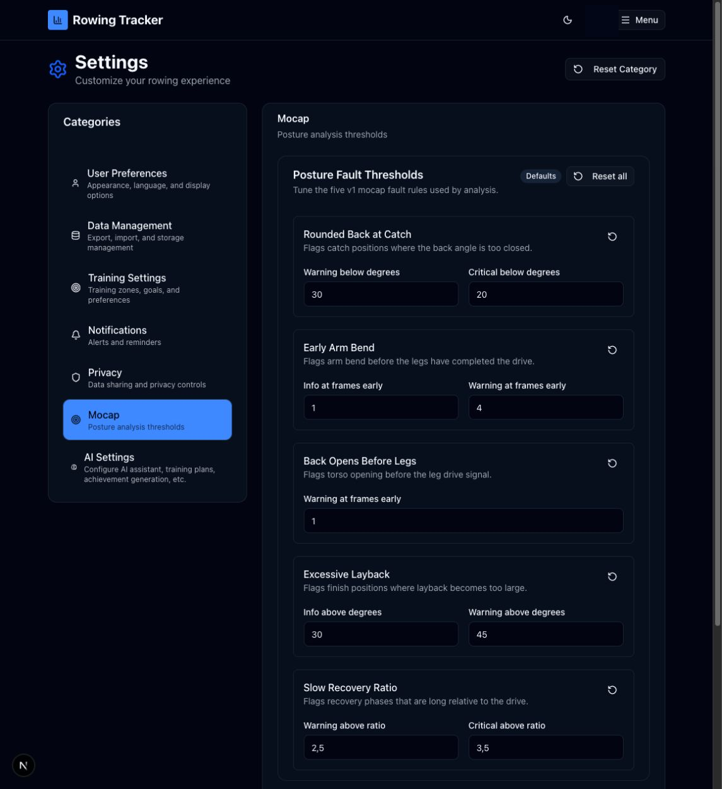
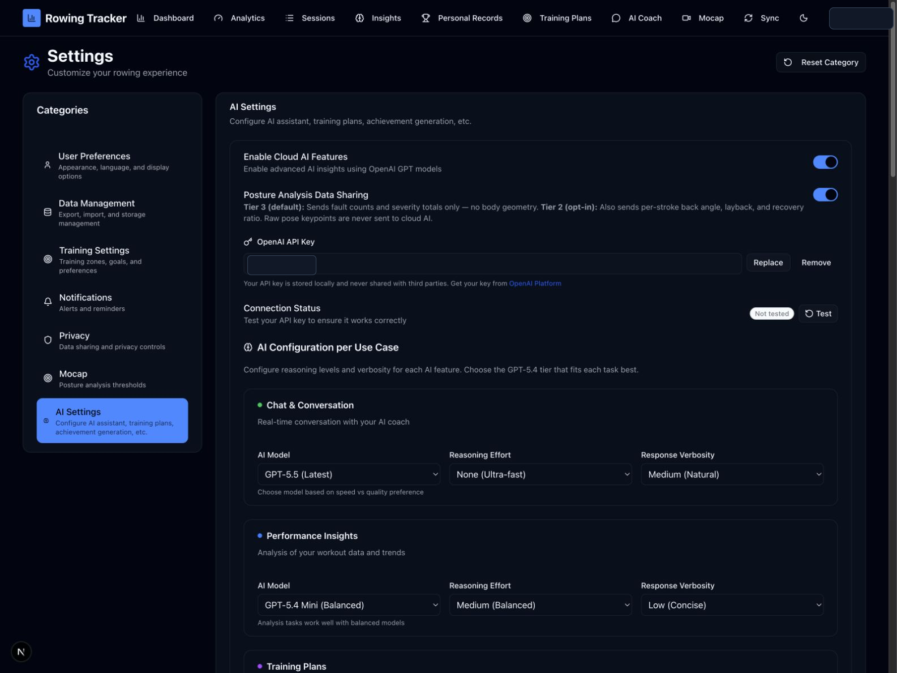

# Settings

Route: `/settings`

Settings is divided into User Preferences, Data Management, Training, Notifications, Privacy, Mocap, and AI Settings. Changes are saved for the current browser/account as applicable.

The left category buttons switch the visible card. **Reset Category** restores every field in the active category to its default after browser confirmation; this overwrites the current category values.

## User Preferences

| Control | What it does |
| --- | --- |
| Theme: Light / Dark / System | Selects the app color scheme. System follows the operating-system preference. |
| Light mode brightness | Adjusts the light-theme background intensity. It is disabled outside Light mode. |
| Units: Metric / Imperial | Changes displayed units across the app. |
| Date format | Selects MM/DD/YYYY, DD/MM/YYYY, or YYYY-MM-DD. |
| Time format | Selects 12-hour or 24-hour time. |
| Language | Selects English, Español, Français, or Deutsch. |
| Default chart type | Selects Line, Bar, or Area for supported charts. |
| Enable animations | Enables or suppresses interface animation. |
| Show default prompt suggestions | Controls built-in AI Coach suggestions. |
| Custom prompt suggestions | Saves one custom suggestion per line for AI Coach. |

## Data Management

| Control or active element | What it does | State or caution |
| --- | --- | --- |
| Storage usage | Reports the browser storage used by tracked local datasets. | Informational. |
| SmartRow email / password | Stores credentials used by Sync Now. | Sensitive data; the eye button reveals/hides the password. |
| Export Settings | Downloads a JSON settings backup. | May include private configuration; store it securely. |
| Import Settings | Loads a compatible settings JSON file. | **Writes settings.** |
| Clear Sessions | Permanently deletes saved rowing sessions after confirmation. | **Destructive.** |
| Clear Chat History | Permanently deletes AI conversations after confirmation. | **Destructive.** |
| Clear Training Plans | Permanently deletes training plans after confirmation. | **Destructive.** |
| Clear Insights Archive | Permanently deletes archived AI insights after confirmation. | **Destructive.** |

## Training

| Control | What it does |
| --- | --- |
| Heart-rate Zone 1–5 minimum/maximum | Defines the five displayed training intensity ranges. |
| Weekly goal type | Uses Sessions, Distance, or Duration as the weekly target unit. |
| Weekly target | Sets the numeric goal for the chosen type. |
| Rest Day Alerts | Enables recovery-day reminders. |
| Enable Training Adaptation | Allows training recommendations to adapt to recorded progress. |

## Notifications

| Control | What it does |
| --- | --- |
| Session Reminders | Enables workout reminders. |
| Weekly Progress | Enables the weekly progress summary. |
| Achievement Alerts | Enables new-record and award notifications. |
| Training Plan Reminders | Enables planned-workout reminders. |
| Adherence Alerts | Enables notifications about plan adherence. |
| Email Notifications | Enables delivery beyond in-app notifications. |
| Email Address | Selects the destination when email delivery is enabled. |
| Email Frequency | Selects Daily, Weekly, or Monthly delivery. |

## Privacy

| Control | What it does |
| --- | --- |
| Anonymous Data Sharing | Permits anonymized product-improvement data sharing. |
| Usage Analytics | Permits collection of feature-usage analytics. |
| Crash Reports | Permits diagnostic crash reporting. |
| Local Storage Only | Restricts supported app data to local storage. |
| Session retention | Sets 1–3650 days before stored sessions are eligible for cleanup. |
| Chat retention | Sets 1–3650 days before stored chats are eligible for cleanup. |

## Mocap

| Control | What it does | State or caution |
| --- | --- | --- |
| Reset all Mocap settings | Restores every threshold and cue preference. | **Overwrites settings** after confirmation. |
| Per-card reset icon | Restores only that fault detector's defaults. | The screen-reader label identifies the affected card. |
| Early knee bend thresholds | Controls when the recovery knee-break detector triggers. | Lower/higher values change detector sensitivity. |
| Incomplete layback thresholds | Controls the finish-angle detector. |  |
| Slouching thresholds | Controls the posture/torso alignment detector. |  |
| Seat leads hands thresholds | Controls the drive-sequence detector. |  |
| Rush at catch thresholds | Controls the catch-timing detector. |  |
| Cue verbosity | Selects Quiet or Verbose technique feedback. | Also available on the capture screen. |
| Audio cues | Enables spoken feedback during Mocap. | Requires browser audio permission/support. |

## AI Settings

| Control or active element | What it does | State or caution |
| --- | --- | --- |
| Enable Cloud AI | Enables features that call the configured AI provider. | Prompt/file content may leave the local device. |
| Detailed posture analysis | Enables higher-tier posture analysis and its displayed data-sharing scope. | Review the on-screen Tier 2/3 notice first. |
| Add / Replace API key | Opens the masked key editor. Save stores it; Cancel discards the edit. | Sensitive secret. |
| Eye icon | Reveals or hides the key while editing. | Avoid revealing it on a shared screen. |
| Remove API key | Deletes the saved provider key. | **Destructive.** |
| OpenAI Platform | Opens the provider's API-key page in a new browser destination. | External link. |
| Test | Tests whether the saved key/provider configuration works. | Makes a provider request. |
| Model / reasoning / verbosity selectors | Configures Chat, Insights, Plans, Personal Context, Achievement Stories, and Award Suggestions separately. | Provider availability and cost vary by model. |
| Image model / quality / size / palette | Configures achievement and story image generation. | Image generation may incur provider cost. |
| Global Max Tokens | Caps supported text-generation output. | Affects response length and possible cost. |
| Personal raw information | Stores optional free text that can inform generated context. | Potentially sensitive; include only what AI features should use. |
| Memory document checkboxes | Selects Coach Memory documents used to generate personal context. | Selected content may be sent to the provider. |
| Generate AI Context | Creates context from the raw information and selected documents. | Makes an AI request and writes the result. |
| Clear | Removes the generated context. | **Destructive.** |
| Generated context editor | Allows direct edits to the effective personal context. | **Writes data.** |
| Prompt buttons | Open editors for System, Chat, Plan Generation, AI Insights, Award Suggestions, Chart Explanation, Story, Image, and Personal Context Generation prompts. | Advanced configuration affects future AI requests. |
| Reset to default / Cancel / Save | In a prompt editor, restores the default text, closes without saving, or saves the edited prompt. | Reset changes the editor; Save persists it. |

## Related modules

- SmartRow credentials are used by [Sync](09-sync.md).
- AI models, context, and prompts affect [AI Coach](07-ai-coach.md), [Insights](04-insights.md), [Training Plans](06-training-plans.md), and [Personal Records](05-personal-records.md).
- Technique thresholds affect [Mocap](08-mocap.md).
