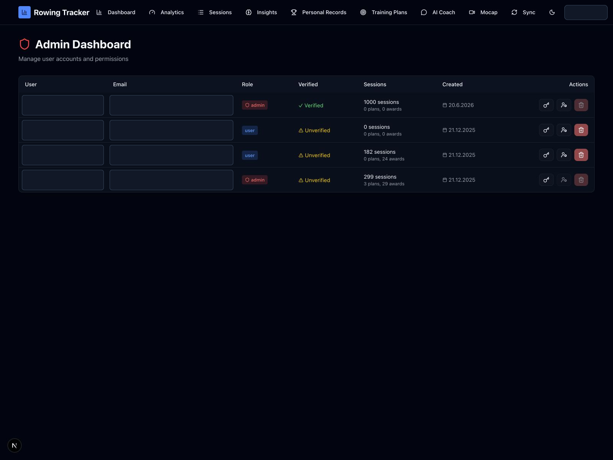

# Administration

Route: `/admin`

Admin Dashboard is available only to administrator accounts. Non-admin users are redirected to the Dashboard. Names, email addresses, and account IDs are masked in the screenshot; roles, verification states, activity totals, creation dates, and action controls remain visible.

## User table

| Column or active element | What it shows or does |
| --- | --- |
| User | Display name and shortened internal user ID. |
| Email | Login email address. |
| Role | User or admin; administrators carry a shield marker. |
| Verified | Whether the email address has been verified. |
| Sessions | Rowing-session count plus training-plan and award totals. |
| Created | Account creation date. |
| Row | Highlights on hover for scanability; it is not itself a link. |

## Row actions

The three action buttons currently use icons without visible text: key, user-with-cog, and trash.

| Control | What it does | State or caution |
| --- | --- | --- |
| Key: Reset Password | Opens a dialog for an administrator to set a password of at least eight characters. Reset Password saves; Cancel closes without saving. | **Security-sensitive write.** |
| User-with-cog: Toggle role | Promotes a user to admin or demotes an admin to user after browser confirmation. | **Permission change.** Disabled for the signed-in administrator's own row. |
| Trash: Delete user | Deletes the account and all associated data after browser confirmation. | **Destructive and irreversible.** Disabled for admins and for the signed-in account. |

Actions are disabled while another administrative request is in progress. A success or error notice appears above the table after the request.

## Related modules

- Users manage their own name, photo, and password in [Profile](10-profile.md).
- General account-local behavior is documented in [Settings](11-settings.md).
