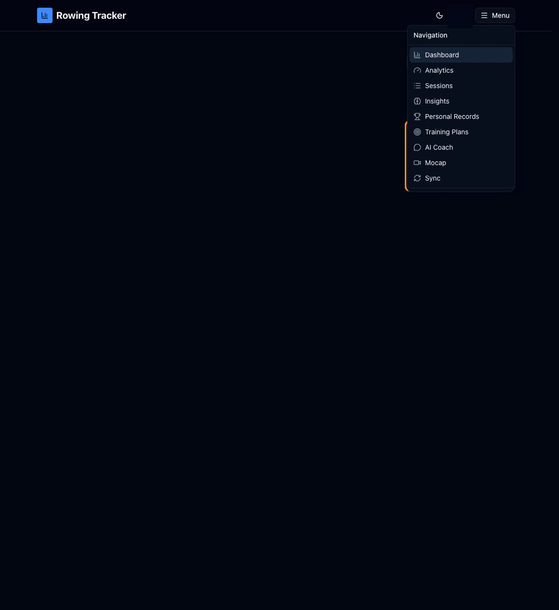

# Rowing Tracker user guide

This guide documents the authenticated Rowing Tracker interface as observed in the running app on July 30, 2026. It covers all nine entries in the main navigation plus the Profile, Settings, and Admin Panel destinations in the account menu.

The screenshots were captured with the current authenticated account. Opaque privacy masks cover direct identifiers, the account photo, workout values and dates, AI-generated content, private document names, video frames, and other account-derived data. Visible availability and enabled states are live examples and will change with the account.

## Navigation

| Control | What it does |
| --- | --- |
| Rowing Tracker logo/title | Returns to `/dashboard`. |
| Theme button | Cycles Light → Dark → System and saves the choice in User Preferences. Its tooltip names the current theme. |
| Account button | Opens the current account summary and the Profile, Settings, Admin Panel, and Logout commands. Admin Panel appears only for administrators. |
| Menu button | Opens all primary modules. The current route is highlighted. |
| Logout | Clears Rowing Tracker-specific local browser state, ends the authenticated session, and returns to `/auth/login`. Unsaved form input is lost. |

The compact menu shown above is used when the whole navigation does not fit in the header. Wider windows display the same module links directly in the header.

## Modules

| Module | Route | Guide |
| --- | --- | --- |
| Dashboard | `/dashboard` | [Dashboard](01-dashboard.md) |
| Analytics | `/analytics` | [Analytics](02-analytics.md) |
| Sessions | `/sessions` | [Sessions and session details](03-sessions.md) |
| Insights | `/insights` | [AI Insights](04-insights.md) |
| Personal Records | `/prs` | [Personal Records and achievements](05-personal-records.md) |
| Training Plans | `/plans` | [Training Plans](06-training-plans.md) |
| AI Coach | `/chat` | [AI Coach and memory](07-ai-coach.md) |
| Mocap | `/mocap` | [Capture, session library, and replay](08-mocap.md) |
| Sync | `/sync` | [SmartRow sync and file import](09-sync.md) |
| Profile | `/profile` | [Profile](10-profile.md) |
| Settings | `/settings` | [Settings](11-settings.md) |
| Admin Panel | `/admin` | [Administration](12-admin.md) |

## Reading the control tables

- **Conditional** means the control appears or becomes enabled only when its prerequisite is satisfied.
- **Writes data** means the control changes saved account data or creates a new record.
- **Destructive** means the control removes or resets saved data. These controls display a confirmation unless the guide says otherwise.
- Charts are active visual elements: hovering a point or bar reveals its values even when the chart has no separate button.

## Authentication screens

Authentication is outside the module menu. An unauthenticated visit is redirected to `/auth/login`; registration, email verification, password reset, magic-link, and optional Google sign-in flows are reached from that screen. This guide used the existing authenticated session and did not log out or expose login credentials.
